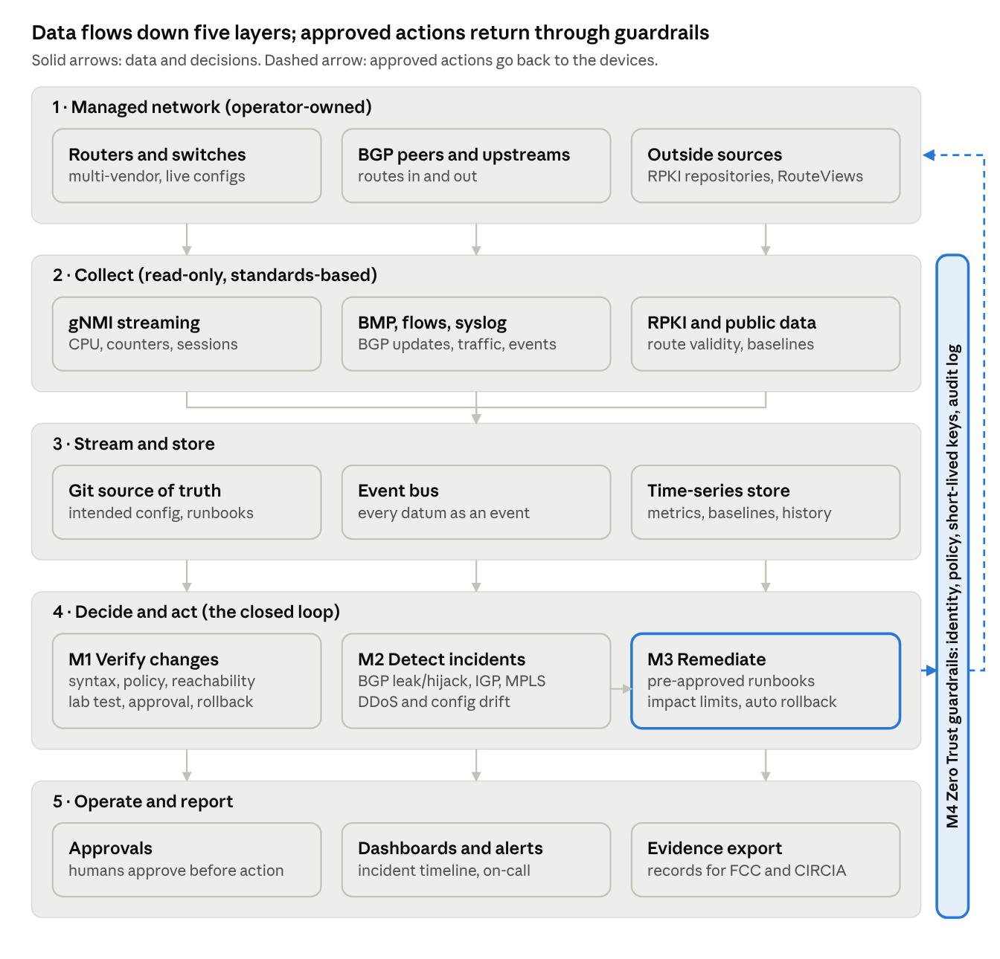
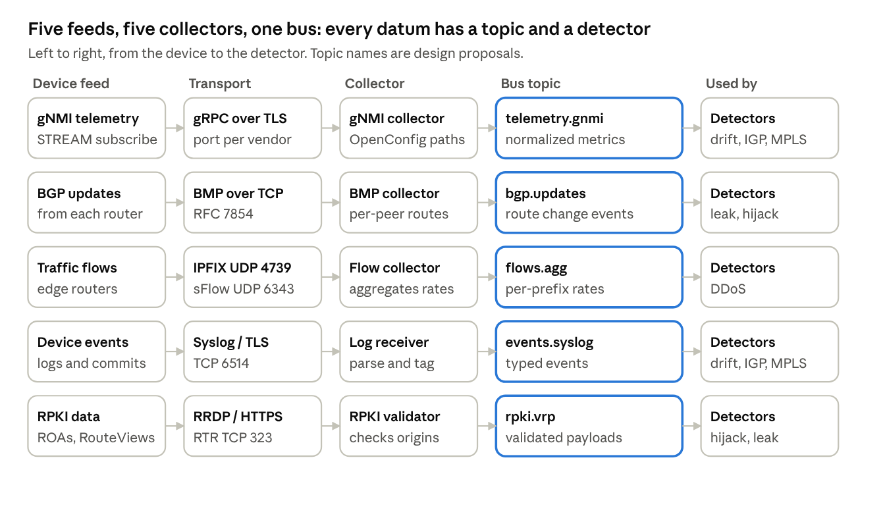
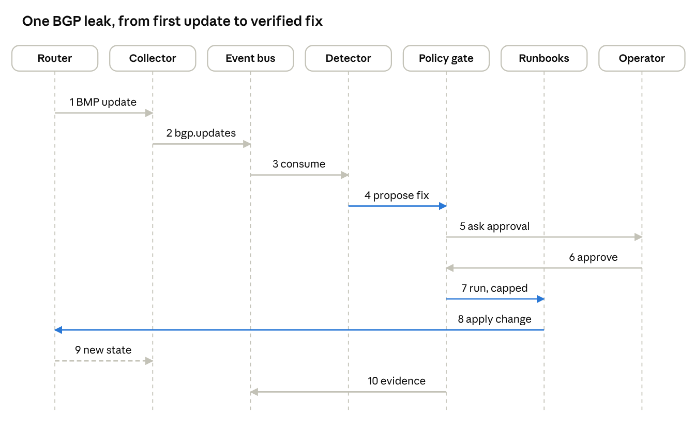

# Architecture

The full document, *Architecture - HLD & LLD* (high-level design, low-level design, detection rules, runbook format, threat model), is in [`Architecture - HLD & LLD.pdf`](Architecture - HLD & LLD.pdf).

## High-level design

Five layers: managed network, collect, stream and store, decide and act (M1 verify, M2 detect, M3 remediate), operate and report. The vertical guardrail (M4) applies identity, policy approval, short-lived credentials and audit to every action that can reach a device. The policy gate is the only component with a path to devices.

## Low-level design

Where each datum comes from and where it goes: Each of the five feeds has its own transport, its own collector and its own topic on the event bus, so a failure in one feed does not stop the others and each detector knows exactly which topics it reads.

## Incident sequence

The table in the top-level `README.md` maps each layer to its source file and implementation status.
